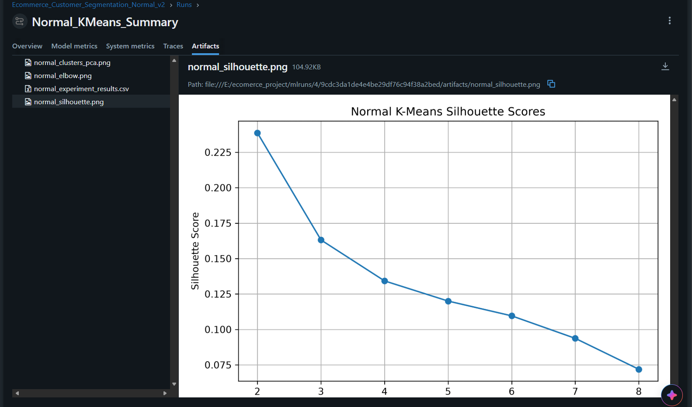
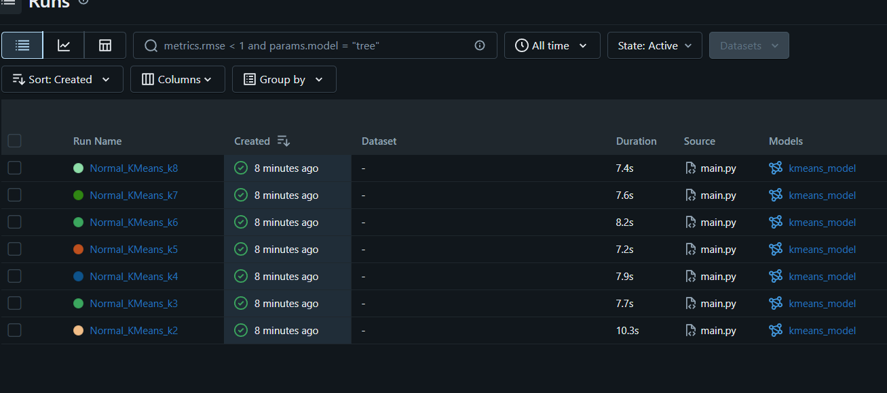
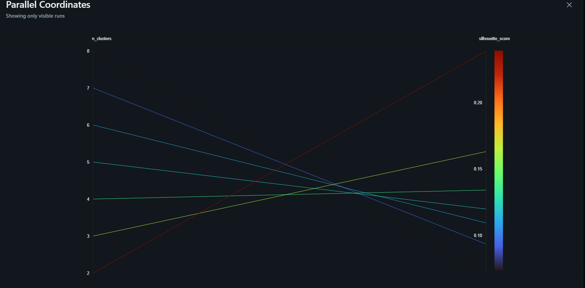

<div align="center">

# 🛍️ Ecommerce Customer Segmentation

### Turn customer signals into clearer, more useful segments.

<p>
  
  
  
  
  
</p>

**An end-to-end machine learning project that explores customer behavior with K-Means, evaluates cluster quality, and tracks experiments in MLflow.**

</div>

---

## The problem

E-commerce businesses collect many signals about customers: what they buy, how often they return, how they browse, and which offers they use. Looking at each customer as one row in a spreadsheet makes it difficult to see meaningful groups or tailor engagement.

## The solution

This project prepares numerical and categorical customer attributes, then applies **K-Means clustering** to discover groups with similar behavior. It compares cluster counts from **K = 2 through 8**, uses the silhouette score to select a candidate, and records parameters, metrics, models, and visual artifacts with **MLflow**. A PCA projection helps visualize the resulting clusters.

The current pipeline is an exploratory segmentation workflow. Its clusters are starting points for analysis, not validated business personas or production recommendations.

## What I learned

- How to prepare mixed customer data: fill missing values, scale numerical features, and one-hot encode categories.
- How K-Means changes as the number of clusters changes, and how to compare inertia with silhouette score.
- Why a clustering metric can guide model selection without proving that segments are useful to a business.
- How to log repeatable experiment parameters, scores, models, and plots with MLflow.
- How PCA can project high-dimensional data into two dimensions for visual inspection.
- How DVC can describe a reproducible training stage and its data dependencies.

## Where it can be used

Teams can use customer segments as an analytical starting point for:

- Exploring differences in purchase frequency, spending, and product preferences.
- Forming hypotheses for targeted campaigns or loyalty programs.
- Prioritizing customer research and designing experiments.
- Comparing segment patterns over time after validating them with business context.

## Experiment snapshots

### Cluster evaluation

The silhouette plot compares candidate cluster counts; in the shown run, the highest score is at **K = 2**.

<p align="center">
  
</p>

### Tracked MLflow runs

<p align="center">
  
</p>

### Comparing runs

<p align="center">
  
</p>

## How it works

1. Load the customer data from `data/ecommerce_customers.csv`.
2. Fill missing numeric values with medians and categorical values with modes.
3. Standardize numeric features and one-hot encode categorical features.
4. Fit K-Means for cluster counts 2–8 and calculate inertia, silhouette score, and training time.
5. Save experiment results and plots; log run data and artifacts in MLflow.
6. Fit a final model using the best silhouette score and visualize clusters with PCA.

## Run it locally

### Requirements

- Python 3.10 or newer
- The dataset at `data/ecommerce_customers.csv`

### Setup

```bash
git clone <your-repository-url>
cd <repository-folder>
python -m venv .venv
```

Activate the environment, then install the project dependencies:

```bash
# Windows PowerShell
.venv\Scripts\Activate.ps1
pip install -r requirement.txt
```

Run the main experiment:

```bash
python main.py
```

The script writes plots and a results CSV under `experiment1_outputs/`. MLflow tracking uses the local `mlflow.db` database. To browse the UI, open another terminal in the environment and run:

```bash
mlflow ui
```

Then visit `http://127.0.0.1:5000`.

## Project files

| Path | Purpose |
|---|---|
| `main.py` | Main K-Means experiment, evaluation, visualization, and MLflow logging |
| `exper.py` | PCA-based experiment workflow |
| `dvc.yaml` | DVC training stage and declared dependencies/outputs |
| `data/ecommerce_customers.csv.dvc` | DVC pointer for the dataset |
| `requirement.txt` | Python dependencies |
| `screenshots/` | MLflow experiment screenshots used above |

## Data note

The CSV is managed with DVC. A fresh clone may need the dataset fetched from the configured DVC remote before `main.py` can run. Check that you have access to that remote, then run `dvc pull`. Do not commit a large dataset directly if DVC is intended to manage it.

## Tags

`customer-segmentation` · `ecommerce` · `machine-learning` · `k-means` · `clustering` · `scikit-learn` · `mlflow` · `dvc` · `pca` · `python`

---

<div align="center">

**Built as a practical exploration of customer analytics and experiment tracking.**

</div>
